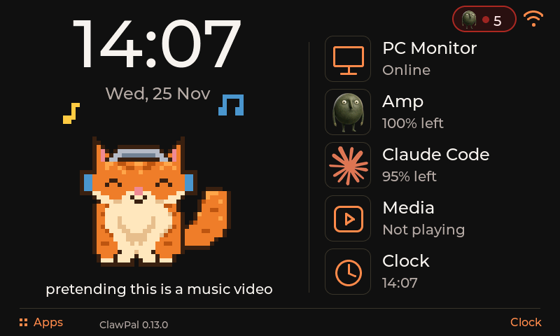
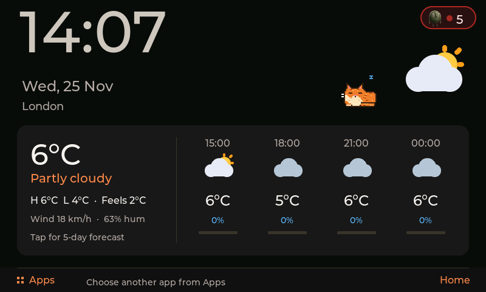
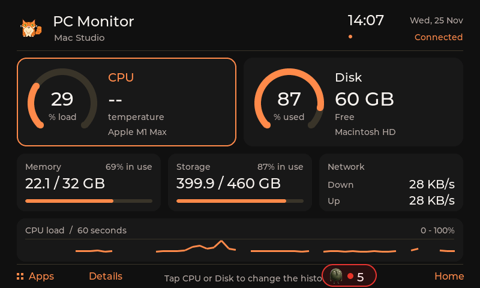
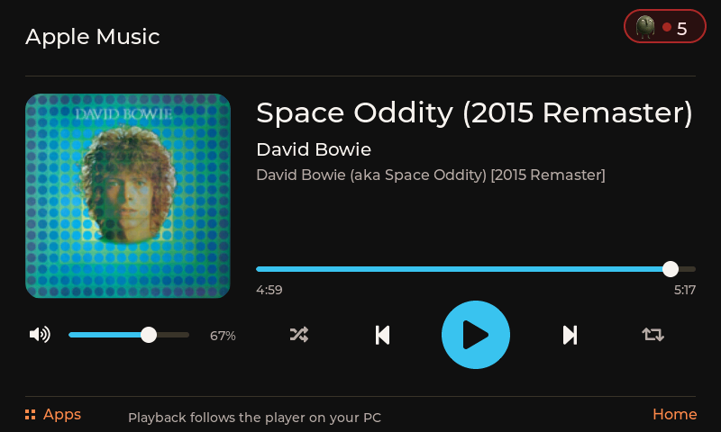
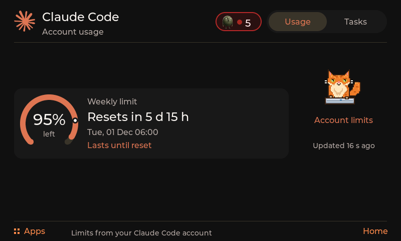
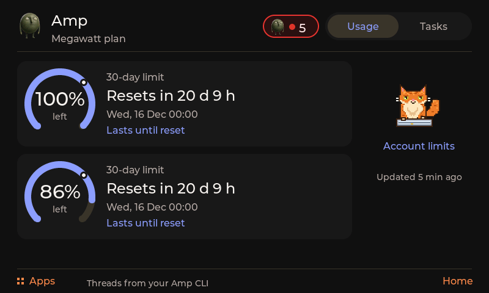
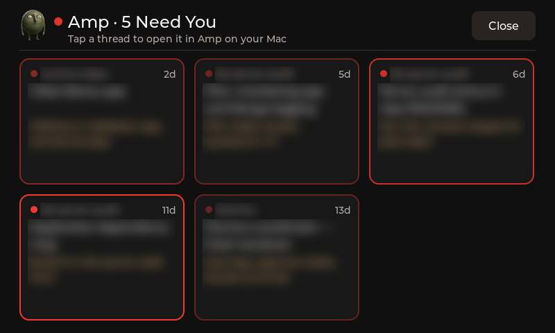
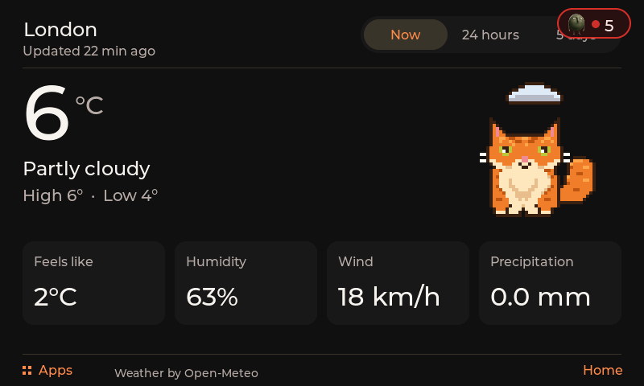

# TeddyPal — macOS Companion & Custom Firmware Patches for ClawPal

**TeddyPal** is a native macOS companion app, flasher/pairing CLI, and set of optional ESP32-S3 firmware patches for the **[Waveshare ESP32-S3-Touch-LCD-4.3B](https://www.waveshare.com/esp32-s3-touch-lcd-4.3b.htm)** desk display.

> **Upstream Credit:** This project is built on top of **[Kaayoos/clawpal](https://github.com/Kaayoos/clawpal)** by MinimalPulse (licensed under GPL-3.0). The display firmware protocol, UI architecture, and official `v0.13.0` firmware come from upstream ClawPal — TeddyPal brings a full macOS experience (no Windows PC required) plus optional hardware, coding-agent, weather, and 8-bit mascot extensions.

---

## Screenshots

| Home (Teddy + Live Summaries) | Clock & Weather Dashboard |
| :---: | :---: |
|  |  |

| Mac Monitor (CPU, Disk, RAM, Net) | Media & NFC Jukebox |
| :---: | :---: |
|  |  |

| Claude Code Usage & Tasks | Amp Usage Gauges |
| :---: | :---: |
|  |  |

| Amp "Need You" Shortcuts (Tap to Open) | Weather Detail |
| :---: | :---: |
|  |  |

---

## Hardware

| Component | Notes | Where to Buy |
| --- | --- | --- |
| **Waveshare ESP32-S3-Touch-LCD-4.3B** (800×480 capacitive touch) | Required display board (case/box variant recommended for desk use) | [The Pi Hut (UK)](https://thepihut.com/products/esp32-s3-development-board-with-4-3-capacitive-touch-lcd-display-800-x-480?variant=43907110305987) · [Waveshare](https://www.waveshare.com/esp32-s3-touch-lcd-4.3b.htm) |
| **M5Stack RFID Unit 2 (WS1850S)** | Optional — plugs into the board's HY2.0 I2C port for the NFC Album Jukebox (with NTAG215/216 cards) | [The Pi Hut (UK)](https://thepihut.com/products/m5stack-rfid-unit-2-ws1850s?variant=41165572309187) |
| **USB-C data cable** | Required for initial flashing (day-to-day telemetry runs over 2.4 GHz Wi-Fi) | Any USB-C data cable |

---

## Features

- **Mac-native flasher & pairer (`clawpal_mac.py`):** Install and verify official signed ClawPal `v0.13.0` firmware directly from macOS, back up your factory flash, configure Wi-Fi/city/theme, and store the pairing token safely in your **macOS Keychain**.
- **Native macOS Menu Bar & Dashboard app (`ClawPalMac/` — SwiftUI):**
  - Live Mac **CPU**, **Memory**, **Disk Space**, **Network**, and **Uptime** telemetry over LAN WebSocket.
  - **Spotify & Apple Music** Now Playing with live album cover upload and bi-directional display controls (play/pause, skip, shuffle, repeat, seek, volume).
  - **Remote Display Control:** switch screens live (`POST /app`), pin Home carousel apps, adjust theme, dimming, night hours, and weather city.
- **Optional — Claude Code integration:**
  - Live **5-hour / 7-day** subscription usage gauges (reads your existing Claude Code Keychain OAuth token read-only, with automatic fallback to Claude Desktop's local `plan-usage-history.json` when the CLI token expires overnight).
  - Reversible hooks + status-line wrapper (`claude_code.py`) plus automatic session title backfill from `~/.claude/projects/` and Claude Desktop's Code tab.
- **Optional — Amp integration:**
  - Live **Amp** usage gauges and **Need You** thread monitoring via the `amp` CLI.
  - With the firmware patch: unobtrusive flashing corner badge (`● N`) → tap to open a responsive 1–8 card grid → tap any card to jump straight to that thread in **Amp.app**.
- **Optional — NFC Album Jukebox:**
  - Plug an **M5Stack RFID Unit 2** (WS1850S, I2C `0x28`) into the Waveshare 4.3B's HY2.0 I2C port.
  - Tap an NTAG215/216 card → starts a mapped Spotify or Apple Music album/playlist, routes audio to your chosen **AirPlay / Sonos / CoreAudio** speaker, and switches the display to the Media screen.
- **Optional — Firmware Patches (`firmware-patches/`):**
  - WS1850S NFC driver, `POST /app` live screen switcher, two-step Amp Need-You alert cards, upgraded 800×440 full-color Weather Clock & 3-hourly forecast dashboard, and **Teddy** — a customizable 8-bit orange Maine Coon cat mascot generator (`generate_cat_mascot.py`).

---

## 1. Prerequisites

- **macOS 14+** with Xcode Command Line Tools (`xcode-select --install`)
- **Python 3.10+** (`brew install python`) for flashing, pairing, and optional Claude Code hooks:
  ```bash
  python3 -m venv .venv
  source .venv/bin/activate
  pip install 'esptool>=5' 'websockets>=15' psutil Pillow
  ```
- A **USB-C data cable** for initial flashing (day-to-day telemetry runs over 2.4 GHz Wi-Fi).

---

## 2. Flash & Pair Official ClawPal Firmware (Mac, no Windows VM)

Find your board's serial port by running `ls /dev/cu.*` before and after plugging in the Waveshare 4.3B (typically `/dev/cu.usbmodemXXXX`):

```bash
source .venv/bin/activate

# Download & SHA-256 verify official Kaayoos/clawpal v0.13.0 release
python3 clawpal_mac.py prepare

# Confirm board connection and back up the factory flash (recommended, ~5-8 min)
python3 clawpal_mac.py identify --port /dev/cu.usbmodemXXXX
python3 clawpal_mac.py backup   --port /dev/cu.usbmodemXXXX

# Flash firmware + Wi-Fi/location settings and save pairing token in Keychain
python3 clawpal_mac.py install  --port /dev/cu.usbmodemXXXX
```

Wait ~30 seconds for the display to connect to your **2.4 GHz** Wi-Fi, then verify pairing:

```bash
python3 clawpal_mac.py discover
```

> **Restore factory flash anytime:** `python3 clawpal_mac.py restore --port /dev/cu.usbmodemXXXX ~/.clawpal-mac/backups/<mac>/flash-….bin`

---

## 3. Build & Run the Native macOS App (`ClawPalMac`)

```bash
./ClawPalMac/scripts/build-app.sh
open ClawPalMac/build/ClawPalMac.app
```

On first launch, macOS will ask for:
- **Local Network access** (to discover and stream to your display over Wi-Fi)
- **Automation** permission for Music / Spotify (for Now Playing & playback controls)
- **Keychain access** for `"ClawPal pairing token"` (click **Always Allow**)

### Avoid Repeated Password Prompts: Persistent Local Code Signing

By default, ad-hoc signed macOS apps (`codesign --sign -`) get a brand-new code hash on every rebuild, which causes macOS Keychain and Accessibility permissions to re-prompt every time you rebuild `ClawPalMac.app`.

To give rebuilds a **stable identity** so Keychain "Always Allow" and Accessibility permissions stick across rebuilds:

1. **Create a 10-year self-signed Code Signing certificate** (one-time):
   - Open **Keychain Access → Certificate Assistant → Create a Certificate…**
   - Name: `ClawPalMac Local Dev`
   - Identity Type: **Self-Signed Root**
   - Certificate Type: **Code Signing**
   - Save it in your **login** keychain.
2. **Trust the certificate for Code Signing** (so macOS honors its Designated Requirement):
   - Double-click `ClawPalMac Local Dev` in Keychain Access → expand **Trust** → set **Code Signing** to **Always Trust** (or run `security add-trusted-cert -r trustRoot -p codeSign -k ~/Library/Keychains/login.keychain-db <cert.pem>`).
   - Verify it shows as valid:
     ```bash
     security find-identity -v -p codesigning
     ```
3. **Rebuild:** `./ClawPalMac/scripts/build-app.sh` automatically detects `"ClawPalMac Local Dev"` (or set `CLAWPAL_SIGN_IDENTITY="Your Cert Name"` and optionally `CLAWPAL_BUNDLE_ID="com.yourname.teddypal"`):
   ```bash
   ./ClawPalMac/scripts/build-app.sh
   codesign --verify --deep --strict ClawPalMac/build/ClawPalMac.app
   ```

> **Alternative headless Python companion:** If you prefer running without the SwiftUI menu-bar app, you can use `python3 clawpal_companion.py run` (or `install-agent` for a `launchd` login agent).

---

## 4. Optional Integrations

### Claude Code (Optional)

1. Install the reversible Claude Code hooks and status-line wrapper (backs up `~/.claude/settings.json` and preserves any existing hooks/status line):
   ```bash
   source .venv/bin/activate
   python3 clawpal_companion.py claude-setup
   ```
   *(To remove later: `python3 clawpal_companion.py claude-remove`.)*
2. Restart any open `claude` terminal sessions.
3. In `ClawPalMac` → **Dashboard → Activity**, toggle **Live account limits (5h / 7d)** on.
   - `ClawPalMac` reads your existing Claude Code Keychain OAuth token **read-only** (never logs, saves, or modifies it).
   - If your CLI OAuth token expires between sessions, it automatically falls back to Claude Desktop's local `plan-usage-history.json` until you open `claude` again.

### Amp (Optional)

- If the **`amp` CLI** is installed and signed in, `ClawPalMac` automatically polls `amp usage` and `amp threads list --json` / `amp threads export` (cached locally in `~/.clawpal-mac/amp_thread_cache.json`).
- **Amp icon:** `build-app.sh` automatically copies the icon from `/Applications/Amp.app` at build time if installed locally (proprietary Amp assets are not redistributed in this repository).
- Without Amp installed, this section simply stays inactive.

### NFC Album Jukebox (Optional)

Requires the patched firmware (see Section 5) and an **M5Stack RFID Unit 2** (WS1850S) plugged into the Waveshare 4.3B's HY2.0 I2C port.

1. Open `ClawPalMac` → **Dashboard → NFC Jukebox**.
2. Choose your preferred **Jukebox Output Speaker** (Default Mac output, any AirPlay / Sonos speaker, or Bluetooth/CoreAudio device).
3. Tap a blank NTAG215/216 card on the reader — its UID fills in automatically.
4. Paste a Spotify album/playlist URL or an Apple Music share URL / library name and click **Save Card**.
   - *(Note: starting un-added Apple Music catalog URLs uses a macOS UI clicker that requires **System Settings → Privacy & Security → Accessibility** for `ClawPalMac`.)*

---

## 5. Optional Custom Firmware Patches & Firmware Signing

The stock official `Kaayoos/clawpal` `v0.13.0` firmware works out of the box with `ClawPalMac`.

If you also want the **NFC Jukebox**, **`POST /app` live screen switcher**, **two-step Amp Need-You cards**, **full-color Weather Clock & forecast**, or **Teddy the 8-bit orange cat mascot**, see **[firmware-patches/README.md](firmware-patches/README.md)** for complete step-by-step instructions to:

1. Clone upstream [Kaayoos/clawpal](https://github.com/Kaayoos/clawpal) at `v0.13.0`
2. Apply the patches with `./firmware-patches/apply.sh ./firmware-fork [--teddy] [--amp-icon]`
3. Generate your own private Ed25519 firmware signing key (`~/.clawpal-mac/signing-key.pem`)
4. Build with ESP-IDF and flash with `python3 clawpal_mac.py flash-fork --port /dev/cu.usbmodemXXXX`

---

## 6. Running Tests

```bash
# Native Swift unit checks (auth, UTF-8 limits, NFC parsing, Claude/Desktop usage, Amp parsing)
swift run --build-system native --package-path ClawPalMac ClawPalChecks

# Python companion & protocol tests
source .venv/bin/activate
python3 tests/run_test.py
python3 tests/run_claude_test.py
python3 tests/run_amp_test.py
python3 tests/run_nfc_test.py
```

---

## Privacy & Security

- **Local-only:** Telemetry travels only over your local Wi-Fi network using ClawPal's HMAC-SHA256 authenticated protocol.
- **No secrets in files:** Pairing tokens live in macOS Keychain; Wi-Fi credentials are written only to a temporary flash image that is deleted immediately after flashing; Claude OAuth tokens are read-only and never logged or written to disk.
- **No private content sent to the display:** Claude Code transcripts, tool inputs, and full file paths are never transmitted — only short sanitized task titles (<63 bytes), leaf folder names, and state/usage metrics.

---

## Credits & License

- **Upstream ClawPal** (firmware, protocol, display UI, original crab mascot): [Kaayoos/clawpal](https://github.com/Kaayoos/clawpal) by MinimalPulse — **GNU GPL v3.0**.
- **TeddyPal** (macOS app, companion CLI, NFC jukebox, Claude/Amp enhancements, firmware patches, Teddy 8-bit cat generator): licensed under **GNU GPL v3.0** — see [LICENSE](LICENSE).
